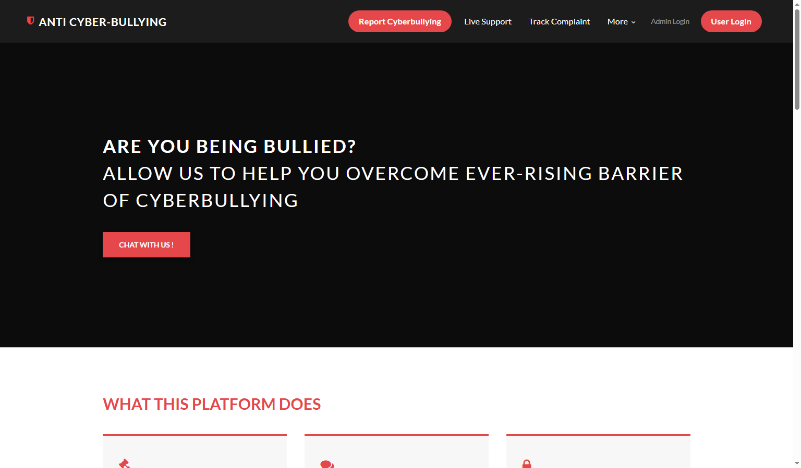
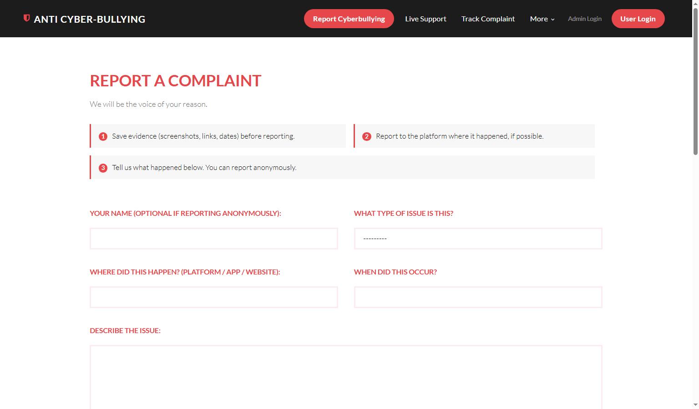
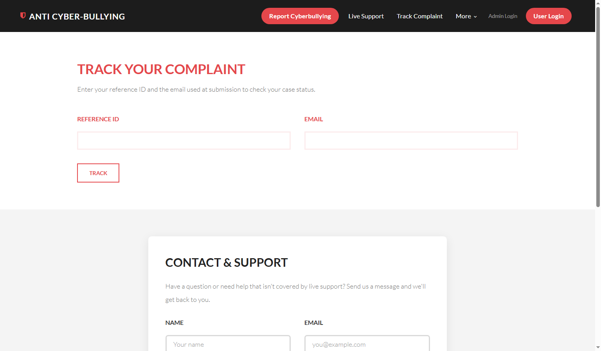
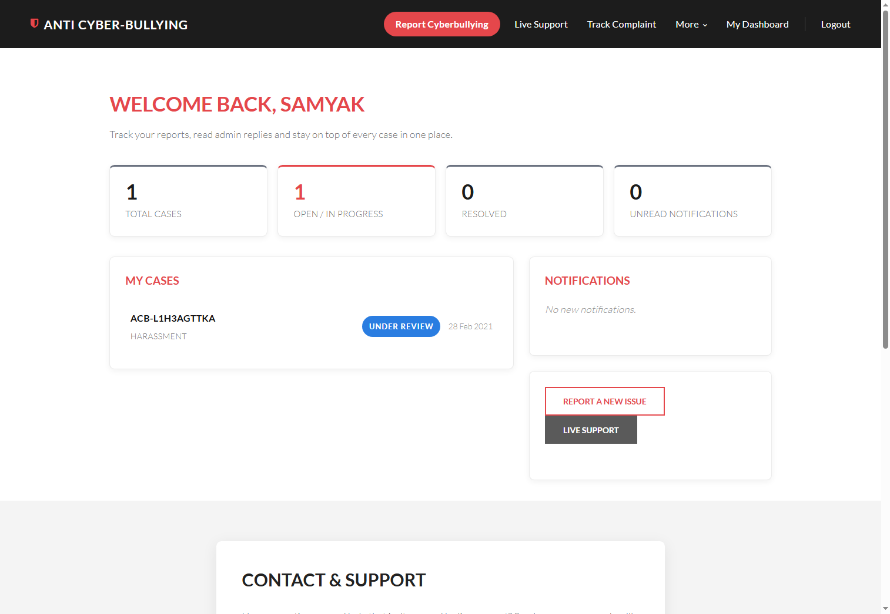
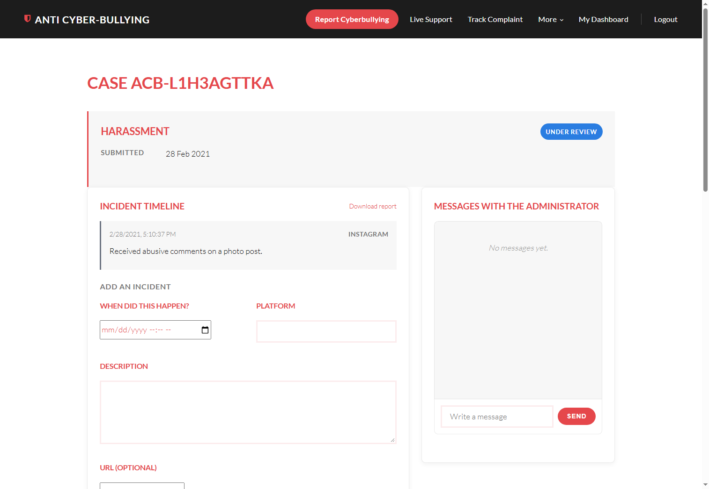
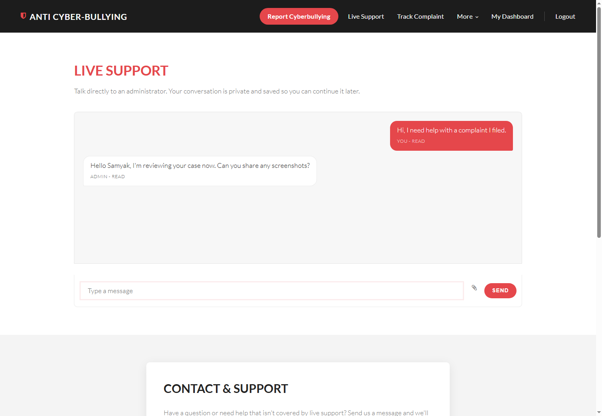
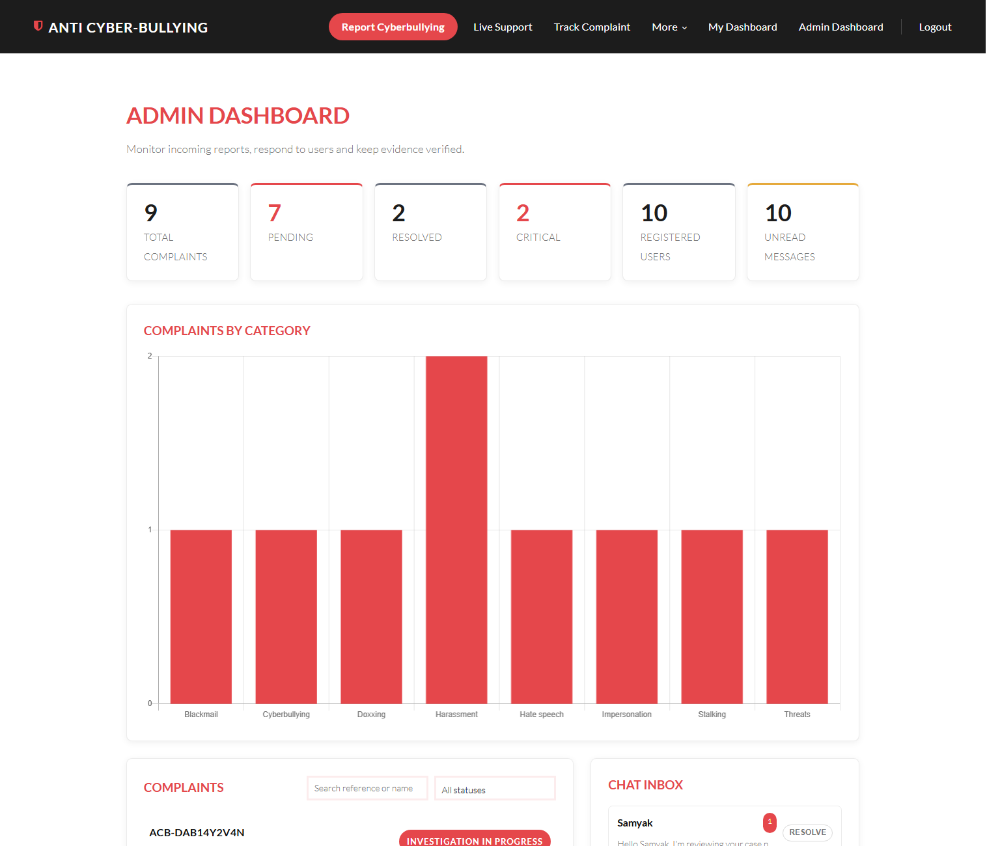

# Hackverse 2.0_Code_Linguists - Anti Cyber-Bullying

## Team Name : Code Linguists

This repository contains the Anti-Cyber-Bullying Web Application, developed for Hackverse 2.0, a hackathon organized by the National Institute of Technology Karnataka (NITK), Surathkal. The hackathon was open to students from colleges across India. 

Submitted for the Primary Track - Let's Stay Safe. 

Ranked in the Top 30 projects overall.

### Live Website Link : https://anti-cyber-bullying.onrender.com/

### Team Members

|        Member name        |                Email Id                 |
| :-----------------------: | :-------------------------------------: |
| Samyak Sand ( Team Lead ) |  samyaksanjaysand.201cs251@nitk.edu.in  |
|    Anirudh Prabhakaran    | anirudhprabhakaran.201ec106@nitk.edu.in |
|        Vivek Dubey        |       dubey.vivek.2805@gmail.com        |

## Feature Screenshots

**Home page**

**Report a complaint**

**Track a complaint**

**User dashboard**

**Case detail, timeline and messages**

**Live chat with an admin**

**Admin dashboard**

### Major Functionalities

- Google OAuth login, with separate entry points for a user and an admin
- Report cyberbullying with evidence (screenshots, links, dates), anonymously or with an account
- Track a complaint by reference ID and see its status update over time
- Live chat with an admin, with read receipts and attachments
- Evidence is hashed on upload so an admin can verify it hasn't been tampered with
- Admin dashboard to review complaints, verify evidence and reply to users

### Objective

In this era of ever-growing technology and new platforms for communication, we are witnessing a rise in cyber bullying activities. The main goal of our hack is to solve this issue by providing assistance to victims as well as monitor sources with a bad/good reputation in such activities.

### What we did ?

Our main focus was to create one user-friendly interface for which I used HTML, CSS and JS to makes the entire UI so that user can come to our website and can easily navigate to different webpages. The live chat environment will provide instant relief where users can get authenticated through Google OAuth and talk to the help desk for personalised assistance.

The chat itself runs over WebSockets, so messages reach the admin instantly without refreshing the page. The app is built on Django.

We also built an admin dashboard where the help desk can see every complaint, verify uploaded evidence and reply to users directly. You don't need an account to report an issue either, you can do it anonymously and still track it later.

### Technical Stack used:

#### Frontend : HTML, CSS, JavaScript
#### Backend : Django, Django Channels, Django REST Framework, Google OAuth, SQLite/PostgreSQL
#### Hosting : Render